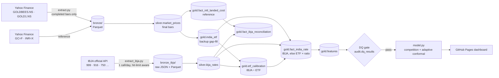

# Delhi Gold Rate Pipeline

An end-to-end data pipeline that forecasts the **Indian gold rate (24K / 22K / 18K, ₹ per 10 g incl. GST)** for a gold buy/sell business in Delhi. It models the Indian price directly, not the international one. It uses three inputs:

- **IBJA**, India's benchmark gold rate, published by the India Bullion and Jewellers Association and used by RBI and banks. It sets the price **level**.
- **Nippon India ETF Gold BeES** (`GOLDBEES.NS`), a gold ETF traded on NSE in rupees. It gives a long daily history of Indian price **moves** on Indian trading days.
- **International gold and USD/INR**, kept as a reference only, to track the Indian premium over the world price.

The pipeline competes several forecasting models in a backtest and publishes a daily dashboard to GitHub Pages, with prediction ranges whose accuracy has been checked.

It is built like a production data platform at small scale:
- a layered (medallion) architecture;
- incremental, idempotent loads;
- a final-bar data contract;
- SQL transforms in DuckDB;
- a data-quality gate;
- source reconciliation;
- orchestration and CI/CD.



## Quick start

```bash
make setup                         # venv + dependencies
export IBJA_API_TOKEN=...          # optional: official IBJA API key (see below)
make run                           # extract → transform → quality → model → report
make test                          # 26 offline tests (synthetic data, mocked API)
open reports/gold_dashboard.html
```

## Data sources

| Source | What | Role |
|---|---|---|
| **Nippon India ETF Gold BeES** (`GOLDBEES.NS`, NSE) via `yfinance` | Daily rupee close on Indian trading days, from 2020 onwards | The modelled Indian price series |
| **Kotak Gold ETF** (`GOLD1.NS`, NSE) | Same, as a backup | Fills the rare days Yahoo drops a Gold BeES bar (2 since 2024). Scaled by the median ratio between the two ETFs, and flagged. |
| **IBJA official API** (`ibjarates.com/API/GoldRates/`) | Daily AM and PM benchmark rates per purity, ₹/10 g, without GST | The price level: used directly when present, and to calibrate the ETF the rest of the time |
| COMEX gold (`GC=F`) and USD/INR (`INR=X`) | International price | Reference only: tracks the Indian premium over international price + duty |

**Why an ETF?** IBJA's API returns only 30 days, while Gold BeES has years of Indian prices. Over 8 days of public IBJA rates (October–November 2026):
- **IBJA ÷ Gold BeES** stayed within **±0.32%** of its median (about 1,218).
- **IBJA ÷ (international price + duty)** swung **6.5–11.3%**.

So the ETF follows the Indian rate closely, including the domestic premium; the international price does not.

**Completed bars only.** A price counts only if it was captured after its market closed: NSE at 15:30 IST, COMEX at 13:30 New York time. Extraction never lands an unfinished day, and the silver layer ignores any older mid-session snapshots. An earlier version scheduled the run before COMEX closed, so it treated mid-morning New York prices as that day's close; this rule exists to prevent that.

**IBJA licensing.** IBJA asks anyone using its rates for pricing or transactions to subscribe to its official API (contact details are on ibjarates.com). The pipeline uses only that API, never scraping. Set the token as an environment variable or as the `IBJA_API_TOKEN` GitHub secret; never commit it. The API serves at most the last 30 days, so history builds up day by day. You can seed older history you've obtained from IBJA with `make import-ibja CSV=…`.

**Without a token**, the Indian rate is Gold BeES × 1,219 (`india.etf_to_ibja_ratio_default`), the ratio observed against IBJA in October–November 2026. It drifts up slowly because of the ETF's expense ratio, so loading IBJA data keeps it calibrated. To match a specific Delhi dealer's board, run `make calibrate RATE=<their 24K ₹/10g incl. GST>`, which sets a local premium.

## How the rate is built

1. **`gold.india_etf`:** Gold BeES closes, with backup-ETF gap-fill.
2. **`gold.etf_calibration`:** the median of IBJA 999 evening rate ÷ Gold BeES close over the last 20 IBJA days, or the config default until IBJA data exists.
3. **`gold.fact_india_rate`:** for each Indian trading day, the IBJA evening rate if it exists, otherwise Gold BeES × ratio. Then add 3% GST plus any local premium. This is what the dashboard shows and the model forecasts.
4. **`gold.fact_ibja_reconciliation`** (reference): shows how closely the ETF tracks IBJA, and the Indian premium over international price + duty. The international side uses the last COMEX close **strictly before** each IBJA date (DuckDB `ASOF JOIN`), so it uses nothing IBJA couldn't have known.

## Forecasting: the most accurate the evidence supports

- **Candidates:** naive (no change), shrunk momentum, Holt's damped trend, and AR(1) on returns.
- **Model competition:** a walk-forward backtest over 500 daily origins scores every candidate at each horizon (next day, 1 week, 1 month). A candidate is used only if it beats naive by at least 2% mean absolute error; otherwise the honest answer is "no change".
- **Adaptive conformal ranges:** errors are standardised by EWMA volatility. Range quantiles are learned online with Adaptive Conformal Inference (Gibbs & Candès, 2021), so the ranges widen automatically after misses in volatile periods.
- **Tracking risk:** the noise in IBJA vs the ETF-implied rate is added to the variance. A prior is used until 20 days of IBJA history exist.
- **Business layer:** an ACCUMULATE / HOLD / LIGHTEN signal, buy and sell quotes per purity, and 1-week 95% value-at-risk on inventory.

**Results** on the Indian series, from 500 daily origins up to 5 Nov 2026, with coverage judged on each day using only information available then:

| Horizon | Model chosen | Error vs naive | 90% range coverage |
|---|---|---|---|
| Next day | naive | best alternative only 0.2% better, so not used | 90.9% |
| 1 week | naive | best alternative 1.6% better, below the 2% bar | 90.8% |
| 1 month | AR(1) | 5.6% better, 70% direction hit | 88.3% |

The 1-month edge comes from trend persistence during the 2024–26 bull market, and it is not statistically significant (Diebold-Mariano p = 0.14). The competition re-runs every day, so if the edge disappears the model switches back to naive automatically.

## Benchmark: open-source foundation models

`make bench` runs Amazon **Chronos-2** and Google **TimesFM 2.5 (200M)** through the same walk-forward test on the Indian series: 500 daily origins, with 1,024 days of history given to each foundation model. A Diebold-Mariano test checks whether any difference from "no change" is statistically real or just luck. Full tables are in [`benchmarks/results/README.md`](benchmarks/results/README.md).

| Horizon | Best pipeline model | Chronos-2 | TimesFM 2.5 |
|---|---|---|---|
| Next day | momentum +0.2% (p 0.66) | **−5.4%** (p 0.005) | **−2.6%** (p 0.014) |
| 1 week | AR(1) +1.6% (p 0.11) | −1.4% (p 0.39) | −1.4% (p 0.24) |
| 1 month | AR(1) +5.6% (p 0.14) | +3.0% (p 0.39) | −0.5% (p 0.72) |

*Error compared with "no change" (positive = better); p is the Diebold-Mariano p-value.*

What the results show:
- **Next day:** both foundation models are significantly *worse* than "no change".
- **Longer horizons:** neither beats the pipeline's simple models.
- **Ranges:** their 80% prediction ranges are miscalibrated. At next day they caught the real price 88–91% of the time (too wide); at 1 month only 64–76% (too narrow).

**Decision:** they are not added to the daily pipeline, which also keeps PyTorch out of CI. The benchmark stays in the repo so they can be re-tested as new versions come out.

**Caveat on the pipeline's own models:** none of their edges is significant at the 5% level. Gold behaves close to a random walk, so the forecast's value is in its calibrated **range**, not its point estimate.

## Data quality gate

There are 18 SQL checks, stored in `audit.dq_results` on every run. Any failure at `error` severity stops the pipeline before the model or the dashboard run, so a bad feed never reaches the published page.

| Area | Checks |
|---|---|
| Indian rate | ETF history loaded; **no daily ETF jump over 15%** (catches unit splits and bad prints; Yahoo's pre-2020 Gold BeES data has one); backup gap-fill used on under 5% of days; no missing rates; freshness |
| Market data | not empty, unique per date and series, price and FX within plausible ranges, freshness, extreme moves in the last 10 days, FX-imputation share |
| IBJA | rates within range; **916/999 purity ratio between 0.90 and 0.93** (catches unit or purity mix-ups); ETF-implied rate within 2% of IBJA; gap to international under 20%; tracking-ratio jump under 3% per day; freshness |

## Deployment

The GitHub Actions workflow is `.github/workflows/daily.yml`:

- **On push and pull request:** run the tests.
- **On schedule (18:30 IST on weekdays, after IBJA's PM print):**
  1. Restore the cached bronze data and warehouse, so loads stay incremental.
  2. Run `make run`.
  3. Build the site, including the last 30 daily snapshots.
  4. Deploy to **GitHub Pages**.
- If anything fails, nothing is deployed and the previous dashboard stays live. If the cache is evicted, the next run reloads the full history; loads are idempotent, so nothing is duplicated.

`dags/gold_pipeline_dag.py` contains the same pipeline as an Airflow DAG, and the `Dockerfile` packages it.

## Project layout

| Path | Purpose |
|---|---|
| `src/goldpipe/extract.py` | Yahoo bronze ingestion: per-series watermarks, completed bars only |
| `src/goldpipe/extract_ibja.py` | IBJA official API client, response parsing, CSV import |
| `sql/01_silver_market.sql`, `sql/02_silver_ibja.sql` | Typing, plus dedupe with `QUALIFY row_number()` so the latest ingest wins |
| `sql/03_gold.sql` | ETF gap-fill and calibration, Indian rate, international reference, `ASOF` reconciliation, features, rate board |
| `src/goldpipe/warehouse.py` | DuckDB connection; turns the config into `ref.*` tables |
| `src/goldpipe/quality.py` | Data-quality gate |
| `src/goldpipe/model.py` | Model competition, adaptive conformal ranges, business signal |
| `src/goldpipe/report.py` | Self-contained HTML dashboard |
| `src/goldpipe/pipeline.py` | CLI with stages, run IDs and logging |
| `benchmarks/foundation_models.py` | Chronos-2 / TimesFM 2.5 benchmark (`make bench`, needs `requirements-bench.txt`) |
| `tests/` | 26 tests: Indian rate (ETF × ratio, IBJA level and calibration), backup-ETF gap-fill, mid-session bars ignored, market-close logic, landed cost, dedupe, FX forward-fill, ASOF no-look-ahead, IBJA parsing, hit-limit skip and errors, DQ gate, idempotency, conformal coverage on a random walk |

## Possible extensions

- Add exogenous drivers (DXY, US 10-year real yield, crude oil) as challenger models in the competition.
- Model the basis directly once IBJA history is long enough. It moves with import demand, festival seasons and duty changes.
- Move the SQL to dbt (`dbt-duckdb`) with schema tests, and host the warehouse on MotherDuck or S3.

---
*Decision support only, not financial advice.*
