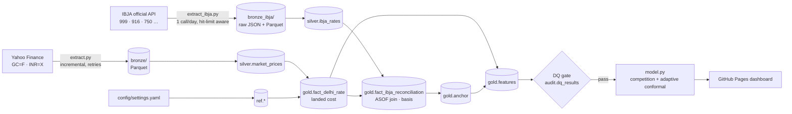

# Delhi Gold Rate Pipeline

An end-to-end data pipeline that forecasts the **Delhi retail gold rate (24K / 22K / 18K)** for a gold buy/sell business. It combines two sources:

- **IBJA**, India's benchmark gold rate, published by the India Bullion and Jewellers Association and used by RBI and banks.
- **Six years of international gold and USD/INR prices** from Yahoo Finance.

It reconciles the two, competes several forecasting models in a backtest, and publishes a daily dashboard to GitHub Pages with prediction ranges whose accuracy has been checked.

It is built like a production data platform at small scale:
- a layered (medallion) architecture;
- incremental, idempotent loads;
- SQL transforms in DuckDB;
- a data-quality gate;
- source reconciliation;
- orchestration and CI/CD.



## Quick start

```bash
make setup                         # venv + dependencies
export IBJA_API_TOKEN=...          # optional: official IBJA API key (see below)
make run                           # extract → transform → quality → model → report
make test                          # 22 offline tests (synthetic data, mocked API)
open reports/gold_dashboard.html
```

## Data sources

| Source | What | How | Why |
|---|---|---|---|
| IBJA official API (`ibjarates.com/API/GoldRates/`) | Daily AM and PM benchmark rates per purity, ₹/10 g, excluding GST | One call per run over a 30-day window. The call is skipped once today's PM rate has landed (the API has a hit limit). | Sets the actual Delhi/India price **level** |
| Yahoo Finance via `yfinance` | COMEX gold futures (`GC=F`) and USD/INR (`INR=X`) | Incremental pull from a high-water mark, with a 5-day overlap and exponential-backoff retries | Long, liquid history that drives the price **moves** |

**Licensing.** IBJA asks anyone using its rates for pricing or transactions to subscribe to the official API (contact details are on ibjarates.com). The pipeline only uses the official API, never scraping. Put the token in an environment variable or the `IBJA_API_TOKEN` GitHub secret; never commit it.

The API only serves the last 30 days, so IBJA history builds up in bronze one day at a time. To seed older history you've obtained from IBJA:

```bash
make import-ibja CSV=ibja_history.csv   # columns: date, session (AM/PM), purity, gold_rate[, silver_rate]
```

**Without a token** the pipeline still runs. It falls back to a landed-cost model, which you can align by hand with `make calibrate RATE=<today's 24K ₹/10g>`.

## How the rate is built

1. **Landed cost**, from `fact_delhi_rate`: Gold US$/oz × USD/INR ÷ 31.1035 × 10 × (1 + import duty) × (1 + GST).
2. **Reconciliation**, in `fact_ibja_reconciliation`: each IBJA print is joined to the latest international close **strictly before** its date, using DuckDB `ASOF JOIN`. COMEX closes around 03:00 IST the next day, so that close is the last price actually known when IBJA published, and there is no look-ahead. `basis_ratio = IBJA ÷ international` captures duty plus the domestic premium or discount.
3. **Anchor**, in `gold.anchor` and `gold.features`: the international history is scaled to the latest IBJA level. Price moves come from 6 years of liquid market data, and the price level is IBJA's.

In October 2026, IBJA was **6.5–8.7% above** the duty-only landed cost. A model without IBJA would have been about ₹9,000–13,000 per 10 g too low.

## Forecasting: the most accurate the evidence supports

- **Candidates:** naive (no change), shrunk momentum, Holt's damped trend, and AR(1) on returns.
- **Model competition:** a walk-forward backtest over 500 daily origins scores every candidate at each horizon (next day, 1 week, 1 month). A candidate is used only if it beats naive by at least 2% mean absolute error; otherwise the honest answer is "no change".
- **Adaptive conformal ranges:** errors are standardised by EWMA volatility. Range quantiles are learned online with Adaptive Conformal Inference (Gibbs & Candès, 2021), so the ranges widen automatically after misses in volatile periods.
- **Basis risk:** the volatility of the IBJA-vs-international basis is added to the variance. A prior is used until 20 days of IBJA history exist.
- **Business layer:** an ACCUMULATE / HOLD / LIGHTEN signal, buy and sell quotes per purity, and 1-week 95% value-at-risk on inventory.

**Results** from 500 daily origins up to 22 Oct 2026, with coverage judged on each day using only information available then:

| Horizon | Model chosen | Error vs naive | 90% range coverage |
|---|---|---|---|
| Next day | naive | best alternative only 0.4% better, so not used | 90.5% |
| 1 week | naive | best alternative 1.9% better, below the 2% bar | 90.1% |
| 1 month | AR(1) | 5.5% better, 68% direction hit | 88.5% |

The 1-month edge comes from trend persistence during the 2024–26 bull market. The competition is re-run every day, so if that edge disappears in a sideways market the model switches back to naive automatically.

## Data quality gate

There are 13 SQL checks, stored in `audit.dq_results` on every run. Any failure at `error` severity stops the pipeline before the model or the dashboard run, so a bad feed never reaches the published page.

| Area | Checks |
|---|---|
| Market data | not empty, unique per date and series, price and FX within plausible ranges, freshness, extreme moves in the last 10 days, FX-imputation share |
| IBJA | rates within range; **916/999 purity ratio between 0.90 and 0.93** (catches unit or purity mix-ups); gap to computed rate under 20%; basis jump under 3% per day; freshness |

## Deployment

The GitHub Actions workflow is `.github/workflows/daily.yml`:

- **On push and pull request:** run the tests.
- **On schedule (18:30 IST on weekdays, after IBJA's PM print):**
  1. Restore the cached bronze data and warehouse, so loads stay incremental.
  2. Run `make run`.
  3. Build the site, including the last 30 daily snapshots.
  4. Deploy to **GitHub Pages**.
- If anything fails, nothing is deployed and the previous dashboard stays live. If the cache is evicted, the next run reloads the full history; loads are idempotent, so nothing is duplicated.

`dags/gold_pipeline_dag.py` contains the same pipeline as an Airflow DAG, and the `Dockerfile` packages it.

## Project layout

| Path | Purpose |
|---|---|
| `src/goldpipe/extract.py` | Yahoo bronze ingestion |
| `src/goldpipe/extract_ibja.py` | IBJA official API client, response parsing, CSV import |
| `sql/01_silver_market.sql`, `sql/02_silver_ibja.sql` | Typing, plus dedupe with `QUALIFY row_number()` so the latest ingest wins |
| `sql/03_gold.sql` | Landed cost, `ASOF` reconciliation, anchor, features, rate board |
| `src/goldpipe/warehouse.py` | DuckDB connection; turns the config into `ref.*` tables |
| `src/goldpipe/quality.py` | Data-quality gate |
| `src/goldpipe/model.py` | Model competition, adaptive conformal ranges, business signal |
| `src/goldpipe/report.py` | Self-contained HTML dashboard |
| `src/goldpipe/pipeline.py` | CLI with stages, run IDs and logging |
| `tests/` | 22 tests: pricing formula, dedupe, FX forward-fill, ASOF no-look-ahead, anchoring and fallback, IBJA parsing, hit-limit skip and errors, DQ gate, idempotency, conformal coverage on a random walk |

## Possible extensions

- Add exogenous drivers (DXY, US 10-year real yield, crude oil) as challenger models in the competition.
- Model the basis directly once IBJA history is long enough. It moves with import demand, festival seasons and duty changes.
- Move the SQL to dbt (`dbt-duckdb`) with schema tests, and host the warehouse on MotherDuck or S3.

---
*Decision support only, not financial advice.*
