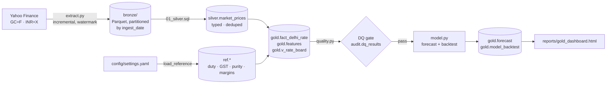

# Delhi Gold Rate Pipeline

An end-to-end data pipeline that ingests international gold and USD/INR market data, models the **Delhi retail gold rate (24K / 22K / 18K)**, forecasts it with backtested uncertainty bands, and publishes a daily decision dashboard for a gold buy/sell business.

It is built like a production data platform at small scale: a medallion architecture, incremental and idempotent loads, SQL transforms in a warehouse, a data-quality gate, orchestration and CI. The forecasting is deliberately honest about what it can and cannot do.



## Quick start

```bash
make setup      # venv + dependencies
make run        # extract → transform → quality → model → report
make test       # 9 offline tests (synthetic data, no network)
open reports/gold_dashboard.html
```

To align the model with your actual Delhi market board rate (dealer premium or discount), pass today's 24K ₹/10 g:

```bash
make calibrate RATE=133950
```

Each stage also runs on its own (`make extract`, `make transform`, `make quality`, `make report`), which is how the Airflow DAG schedules and retries them.

## Project layout

| Path | Purpose |
|---|---|
| `src/goldpipe/extract.py` | Bronze ingestion: incremental pull from a high-water mark with a 5-day overlap to catch revisions; append-only Parquet |
| `sql/01_silver.sql` | Dedupe with `QUALIFY row_number()`, where the latest ingest wins |
| `sql/02_gold.sql` | Fact table on the gold trading calendar, FX forward-fill (`last_value … IGNORE NULLS`), landed-cost model, SMA features, purity rate board view |
| `src/goldpipe/warehouse.py` | DuckDB connection; turns the YAML config into `ref.*` tables so the business rules live in SQL and can be audited |
| `src/goldpipe/quality.py` | Declarative SQL checks with error/warn severity, results kept in `audit.dq_results`, and the pipeline stops on any error |
| `src/goldpipe/model.py` | Ensemble forecast, walk-forward backtest against a naive baseline, business signal and inventory VaR |
| `src/goldpipe/report.py` | Self-contained HTML dashboard |
| `src/goldpipe/pipeline.py` | CLI with stages, run IDs and structured logging |
| `dags/gold_pipeline_dag.py` | Airflow DAG (weekdays 18:30 IST, 3 retries) |
| `.github/workflows/daily.yml` | CI: tests on push; scheduled run with the warehouse cached between runs; dashboard uploaded as a build artifact |
| `tests/` | Pricing formula, dedupe, FX forward-fill, DQ gate, idempotency, forecast invariants |

## Pricing model

```
Delhi 24K ₹/10g = (Gold USD/oz × USD/INR ÷ 31.1035 × 10)
                  × (1 + import duty 6%) × (1 + GST 3%)
                  + local premium (calibrated)
22K = 24K × 0.916/0.999,  18K = 24K × 0.750/0.999
We buy = market × (1 − buy margin),  We sell = market × (1 + sell margin)
```

All parameters are in `config/settings.yaml`. If the budget changes import duty, you update one number.

## Forecasting approach

- **Ensemble:** a shrunk 60-day momentum drift plus Holt's damped trend on log prices.
- **Uncertainty:** EWMA volatility (30-day half-life) scaled by √horizon gives 90% ranges.
- **Signal:** ACCUMULATE, HOLD or LIGHTEN, from P(up in 1 week) together with the 50-day trend.
- **Risk:** 1-week 95% value-at-risk on current stock.
- **Walk-forward backtest:** runs every time and is compared with the naive "price stays the same" forecast.

Gold behaves close to a random walk, so direction hit rates near 50% are expected, and the point forecast barely beats the naive one. The **range** is where the business value is: its coverage in the backtest shows whether the bands can be trusted for setting buy-back and sell quotes and for sizing inventory.

## Design decisions

- **DuckDB + Parquet** gives warehouse semantics (SQL, schemas, window functions) with no infrastructure. The same SQL ports to Snowflake, BigQuery or Databricks with only small dialect changes.
- **Bronze is immutable.** Silver and gold can be rebuilt from it at any time, which allows replay and backfills, and a logic bug never loses data.
- **Idempotent writes.** Forecasts are keyed by `as_of_date` using delete-then-insert, so re-running a day never duplicates rows.
- **Grain = COMEX trading days**, with FX forward-filled and flagged (`fx_imputed`) instead of being silently interpolated.
- **The DQ warning for extreme moves only checks the last 10 days.** Historic shocks such as the Jan-2026 crash are real, so the check flags only new anomalies that need a person to look at them.

## Possible extensions

- Scrape or ingest IBJA / MCX rates as ground truth, then add a `calibration` fact and track drift.
- Move transforms to dbt (`dbt-duckdb`) with schema tests.
- Store the warehouse in S3 or MotherDuck, and publish the dashboard to GitHub Pages.
- Add exogenous features (DXY, US 10Y real yield, crude) and compare models in MLflow.

---
*Decision support only, not financial advice.*
